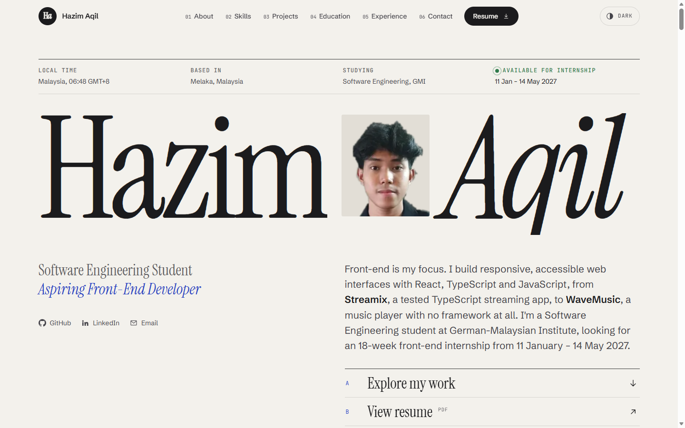

# Hazim Aqil — Front-End Developer Portfolio

My personal portfolio: an editorial, responsive site with light and dark themes that presents my front-end projects, skills, education and internship availability, with a case study page for every project.

**Live site:** https://hazimaqil-portfolio.netlify.app



> Software Engineering student at German-Malaysian Institute (GMI) and aspiring front-end developer. I build responsive, accessible web interfaces with React, TypeScript and JavaScript.
> **Available for internship: 11 January – 14 May 2027.**

---

## Features

- **Project explorer** (React island): filters for All, Web, Desktop and Mobile with `aria-pressed` buttons and counts, a contents list that follows your scroll, a live "Showing 3 projects" message, and the choice kept in the address (`/?filter=desktop`) so a filtered view can be shared and survives the back button.
- **Featured front-end work first**: Streamix, WaveMusic, HazStore and HazFocus lead the list; HazCast and the Yes, Halal team project follow; the Windows tools sit in a separate "Supporting desktop work" group.
- **A page for every project**: nine case studies built from one data file, with overview, team role, features, a "How the front end works" section (checked against each project's source code), architecture, challenges and decisions, testing, screenshots and what I learned. A section only appears when there is real content for it.
- **Live repository panel** (React island): project pages with a public repository show its last push, main language and a commit history link, read from the GitHub REST API. It starts as a plain link, shows a loading note, handles rate limits and errors, caches answers for 30 minutes and cancels the request if you leave.
- **Screenshot gallery** (React island) on the native `<dialog>`: arrow buttons and keys, Esc or the backdrop to close, page scroll locked while open, focus back to the button that opened it.
- **Skills connected to projects**: front-end skills first, tools and supporting knowledge after. Each skill shows the numbers of the projects that use it, and a `site` tag where this portfolio itself uses it. No percentage bars.
- **Light and dark themes** (React island) that follow the system setting, can be switched by hand, are saved in localStorage and load without a flash.
- **Contact form** (React island) on Netlify Forms with a spam honeypot, per-field errors linked to their fields, a sending state, a 15 second time limit, and a success message only when Netlify really accepted the message. Without JavaScript the same form posts to Netlify the normal way.
- **Accessibility**: skip link, landmarks, one `h1` per page, alt text on every image, visible focus, keyboard friendly menu and dialog, and no motion when the system asks for reduced motion. Checked with axe on every page type in both themes.
- **Performance**: static HTML first, React only where something is interactive, responsive WebP images in several sizes, self-hosted fonts with the above-the-fold faces preloaded, and lazy loading below the fold.
- **SEO**: a title, description and canonical link on every page, Open Graph and Twitter cards with a 1200×630 image, JSON-LD structured data, `robots.txt`, a sitemap and a 404 page.

## Tech stack

| Area | Tools |
|---|---|
| Site | [Astro 7](https://astro.build) (static output), TypeScript in strict mode |
| Interactive parts | React 19 islands through `@astrojs/react`, hooks only (no state library) |
| Styling | Plain CSS with custom properties, split into one file per part (`src/styles/`) |
| Fonts | Instrument Serif, Schibsted Grotesk and JetBrains Mono, self-hosted through Fontsource |
| Data | GitHub REST API (public, no key) for the repository panel |
| Testing | Vitest and React Testing Library (unit, hooks, components), Playwright (end to end), axe-core (accessibility) |
| Quality | `astro check`, ESLint with typescript-eslint, eslint-plugin-astro and the React hooks rules |
| Hosting | Netlify, with Netlify Forms for the contact form |

## Architecture

Content lives in typed data files. Astro renders every page to static HTML, and React only takes over the parts that need state in the browser.

```
src/data/*.ts  ──►  src/lib/*.ts (pure helpers)  ──►  src/components/*.astro  ──►  src/pages/*.astro
   (content)         filters, validation,               static sections            home, project pages,
                     theme rules, images                     │                       404, robots.txt
                                                             ▼
                              src/components/react/*.tsx  (islands: theme, projects, gallery, repo, contact)
                                     │ uses
                                     ▼
                              src/hooks/*.ts  ──►  src/services/*.ts  (network: github, netlify forms)
```

- **`src/data/`** holds every fact on the site: `site.ts` (name, title, links, navigation), `profile.ts` (about, skills, education, courses, experience, jobs) and `projects.ts` (all nine projects). The types are in `src/types/content.ts`.
- **`src/lib/`** has pure functions shared by pages, islands and tests: project filters (`projects.ts`), contact rules (`validation.ts`), theme rules (`theme.ts`), the `**bold**` / `` `code` `` renderer (`inline.ts`), and `images.ts`, which turns an optimised Astro image into plain URLs an island can use.
- **`src/components/react/`** holds the islands and their small parts:
  - `ui/`: `Button`, `Icon`, `ExternalLink`, `Modal` (native `<dialog>` with a fallback when `showModal` is missing).
  - `ThemeToggle.tsx`, hydrated when the browser is idle.
  - `projects/`: `ProjectExplorer`, `ProjectFilters`, `ProjectCard`, `ProjectGallery`, `RepoActivity`.
  - `contact/`: `ContactForm`, `FormField`.
  - Each island gets plain, typed props from Astro, so images stay optimised at build time.
- **`src/hooks/`** keeps the state logic out of the components:
  - `useTheme` and `useQueryParam` are built on `useSyncExternalStore`, with a server snapshot so hydration always matches.
  - `useProjectFilter`, `useActiveItem` (IntersectionObserver) and `useMediaQuery` / `usePrefersReducedMotion`.
  - `useIsClient` hides buttons that only work with JavaScript until React runs.
  - `useGitHubRepo` covers the loading, success and error states, and cancels with AbortController.
  - `useContactForm` is a reducer holding values, errors and send status; the reducer is exported and tested on its own.
- **`src/services/`** is the only code that talks to the network:
  - `http.ts`: `fetchWithTimeout`, which combines a time limit with the caller's abort signal.
  - `github.ts`: validates the API answer before use, and caches it in sessionStorage.
  - `contact.ts`: posts to Netlify Forms.
- **`src/scripts/`** keeps the small vanilla parts that need no React: menu, scroll progress and active section, reveal on scroll, and the clock. `main.ts` starts each one on its own.
- **`src/pages/projects/[slug].astro`** builds one page per project with `getStaticPaths`, so adding a project to `projects.ts` adds its page, card, filter count, sitemap entry and links automatically.

## Folder structure

```
portfolio/
├── public/                    files served as they are
│   ├── assets/                icons, profile.jpg, resume.pdf
│   ├── og/og-default.png      1200×630 link preview image
│   └── favicon.ico
├── src/
│   ├── assets/images/         images optimised at build time (projects, case, people)
│   ├── components/
│   │   ├── home/              Hero, About, Skills, Projects, Education, Experience, Contact
│   │   ├── layout/            BaseHead, Header, Footer
│   │   ├── project/           CaseIntro, CaseSection, CaseGallery, CasePager
│   │   ├── react/             islands: ThemeToggle, projects/, contact/, ui/
│   │   └── ui/                Icon, IconSprite, ExternalLink, SectionHead, RichText
│   ├── data/                  site.ts, profile.ts, projects.ts
│   ├── hooks/                 useTheme, useQueryParam, useProjectFilter, useGitHubRepo, useContactForm, ...
│   ├── layouts/               BaseLayout.astro
│   ├── lib/                   analytics.mjs, images.ts, inline.ts, projects.ts, theme.ts, validation.ts
│   ├── pages/                 index, projects/[slug], 404, robots.txt
│   ├── scripts/               vanilla modules (menu, scroll, reveal, clock), started by main.ts
│   ├── services/              http.ts, github.ts, contact.ts
│   ├── styles/                tokens, base, one file per section, responsive, global.css
│   └── types/content.ts
├── tests/
│   ├── setup.ts               jest-dom matchers and browser stand-ins for jsdom
│   ├── unit/                  vitest: helpers, services, reducer, data checks
│   │   └── components/        react testing library: islands and hooks
│   └── e2e/                   playwright: pages, home, project pages, contact form, axe
├── docs/screenshots/           desktop and mobile screenshots
├── astro.config.mjs
├── netlify.toml               build, redirects and security headers
├── playwright.config.ts
├── vitest.config.ts
└── eslint.config.js
```

## Setup

Requires **Node.js 22.12 or newer**.

```bash
npm install
```

```bash
npm run dev
```

The dev server runs at http://localhost:4321.

## Scripts

| Command | What it does |
|---|---|
| `npm run dev` | start the dev server |
| `npm run build` | build the static site into `dist/` |
| `npm run preview` | serve the built site locally |
| `npm run check` | type check TypeScript, Astro and React files |
| `npm run lint` | run ESLint |
| `npm test` | run the unit and component tests once |
| `npm run test:watch` | run the unit and component tests on every change |
| `npm run test:e2e` | build, serve and run the Playwright tests |
| `npm run verify` | everything above in order: check, lint, unit tests, build, end to end |

## Environment variables

| Name | Needed | Default | Used for |
|---|---|---|---|
| `SITE_URL` | no | `https://hazimaqil-portfolio.netlify.app` | canonical links, the sitemap, robots.txt, link previews and structured data |
| `GOATCOUNTER_CODE` | no | not set, so nothing is counted | page view counts with [GoatCounter](https://www.goatcounter.com): the `name` in `name.goatcounter.com` |

Copy `.env.example` to `.env` to change it locally. On Netlify, set it under **Site configuration → Environment variables**, for example when the site moves to its own domain. The site needs no secret keys: Netlify Forms needs none, and the GitHub panel uses the public API without a token, so no token is ever shipped to the browser.

**Page view counts:** when `GOATCOUNTER_CODE` is set, every page loads GoatCounter's script from `gc.zgo.at`, and the Content Security Policy allows that script and the counter's own address. GoatCounter sets no cookies, so the site still has no cookie banner. Set the code only on Netlify, so local builds and tests are never counted. The code is checked by `src/lib/analytics.mjs`, and anything that is not a valid code turns counting off.

## Testing

```bash
npm test
```

```bash
npx playwright install chromium
```

```bash
npm run test:e2e
```

- **Unit tests** (`tests/unit/*.test.ts`, Node): the helpers, contact rules, theme rules, html escaping, the contact reducer, the GoatCounter code check, the GitHub service (URL parsing, answer validation, caching, each error status) and `fetchWithTimeout` (time limit and caller abort, with fake timers). There are also checks on the real data: unique slugs, https links, alt text, and skill links that point at real projects.
- **Component and hook tests** (`tests/unit/components/*.test.tsx`, jsdom with React Testing Library):
  - `ThemeToggle`: label, saving, following outside changes.
  - `ProjectExplorer`: counts, filtering, the URL, the live message, unknown filters.
  - `ProjectGallery`: open, step, wrap, keys, close, focus return.
  - `RepoActivity`: loading, then success; rate limit; cancel on unmount.
  - `ContactForm`: errors linked to fields, focus, error clearing, sending state, success only after an ok answer, failure keeps the text, honeypot.
  - `useQueryParam` and `useProjectFilter`.
- **End to end tests** (`tests/e2e/`) run against the production build at desktop and phone sizes. They wait for each island to hydrate before using it. They cover:
  - every page loading without console errors, the 404 page, robots and the sitemap
  - the resume, safe external links, theme memory across pages
  - the filter, its address and the featured order
  - menu navigation, the mobile menu and the skip link
  - case study contents, the front-end section, previous/next and related links
  - the lightbox, and the repository panel with GitHub mocked, for both success and refusal
  - the Netlify detection form, and the contact form's errors, success and failure
  - an axe scan of every page type in light and dark mode
- The contact tests answer the form's request themselves (status 200, then status 500). Real delivery through Netlify Forms can only be checked on the deployed site.
- To use an installed browser instead of downloading Chromium, set `PW_CHANNEL=msedge` or `PW_CHANNEL=chrome`.

Results on 24 November 2026: 93 unit and component tests passed; 94 end to end tests passed and 4 were skipped (tests that only apply to the other screen size); `astro check` reported 0 errors; ESLint reported 0 problems.

### Lighthouse

Local results, measured on 16 November 2026 with Lighthouse 13.6 in headless Edge against `npm run preview`:

| Page | Device | Performance | Accessibility | Best practices | SEO | LCP | TBT | CLS |
|---|---|---|---|---|---|---|---|---|
| Home | Mobile | 99 | 100 | 100 | 100 | 1.1 s | 130 ms | 0.002 |
| Home | Desktop | 100 | 100 | 100 | 100 | 0.3 s | 0 ms | 0.005 |
| Streamix case study | Mobile | 100 | 100 | 100 | 100 | 0.8 s | 70 ms | 0.001 |
| Streamix case study | Desktop | 100 | 100 | 100 | 100 | 0.2 s | 0 ms | 0.001 |

Live results, measured on 24 November 2026 with Lighthouse 13.6 in headless Edge against https://hazimaqil-portfolio.netlify.app (one run each, so expect some variation between runs):

| Page | Device | Performance | Accessibility | Best practices | SEO | LCP | TBT | CLS |
|---|---|---|---|---|---|---|---|---|
| Home | Mobile | 87 | 100 | 92 | 100 | 1.7 s | 460 ms | 0 |
| Home | Desktop | 99 | 100 | 92 | 100 | 0.6 s | 0 ms | 0.005 |
| Streamix case study | Mobile | 100 | 100 | 92 | 100 | 1.3 s | 0 ms | 0 |
| Streamix case study | Desktop | 98 | 100 | 92 | 100 | 0.5 s | 0 ms | 0.002 |

Best practices is 92 on every live page because Netlify adds its own badge script (`/.netlify/scripts/hud`) to published sites, and the Content Security Policy blocks the inline code it tries to run, which logs console errors. The site's own code logs none. On the home page on mobile, the first response from the server took 820 ms in that run.

## Build and deploy

The Netlify setup is split so it works for both kinds of deploy:

- **`netlify.toml`:** build settings (`npm run build`, publish `dist`, Node 22). Netlify only reads it when it builds from the Git repository.
- **`public/_redirects`:** the old `/projects/<name>.html` and `/index.html` addresses go permanently to the new clean ones.
- **`public/_headers`:** `X-Content-Type-Options`, `X-Frame-Options`, `Referrer-Policy`, `Permissions-Policy` and `Cross-Origin-Opener-Policy` on every page, and long caching for the hashed files in `/_astro/`. Astro adds a Content Security Policy with hashes for its inline scripts to every page; `connect-src` allows only this site and `api.github.com`, plus the GoatCounter address when counting is on.
- **Forms:** the visible form is a React island, so `Contact.astro` also renders a hidden copy with the same name and fields (`data-netlify="true"`) for Netlify to detect at deploy time. Form detection must be on under **Forms** in the Netlify dashboard. Messages appear there, and email alerts are set under **Site configuration → Notifications → Form submission notifications**.
- **404:** `dist/404.html` is served for any unknown address.

Everything in `public/` is copied into `dist/`, so the redirects and headers apply however the site is deployed.

**From Git (how this site is deployed):** the repository is connected in Netlify, so every push to `main` builds with the settings in `netlify.toml` and goes live.

**Drag and drop:**

```bash
npm run build
```

Then drop the `dist` folder (not the project folder) onto **Deploys** in the Netlify dashboard.

## Projects featured

| Project | Type | Stack | Links |
|---|---|---|---|
| Streamix | Web (featured) | React, TypeScript, Vite, Tailwind, Vitest | [Demo](https://streamix-hazim.netlify.app) · [Code](https://github.com/hazell-lab/Streamix) |
| WaveMusic | Web (featured) | HTML, CSS, JavaScript, Media Session API | [Demo](https://hazell-lab.github.io/wavemusic/) · [Code](https://github.com/hazell-lab/wavemusic) |
| HazStore | Web (featured) | React, Vite, React Router, Vitest, Playwright | [Demo](https://hazstore-ecommerce.netlify.app) · [Code](https://github.com/hazell-lab/haz-store) |
| HazFocus | Web (featured) | HTML, CSS, JavaScript | [Demo](https://hazell-lab.github.io/haz-focus/) · [Code](https://github.com/hazell-lab/haz-focus) |
| HazCast | Web | HTML, CSS, JavaScript, Open-Meteo API | [Demo](https://hazell-lab.github.io/Haz-Cast/) · [Code](https://github.com/hazell-lab/Haz-Cast) |
| Yes, Halal | Mobile (team final year project) | Flutter, Dart, Node.js, Firestore | — |
| ClipNest | Desktop (supporting) | C#, .NET 10, WPF, SQLite | [Code](https://github.com/hazell-lab/ClipNest) |
| Kite | Desktop (supporting) | C#, .NET 10, WPF | [Code](https://github.com/hazell-lab/kite) |
| IslandBar | Desktop (supporting) | C#, .NET 8, WPF, NAudio | [Code](https://github.com/hazell-lab/IslandBar) |

## Contact

- **Email:** mdhazim.aqil@gmail.com
- **LinkedIn:** [linkedin.com/in/mdhazimaqil](https://www.linkedin.com/in/mdhazimaqil/)
- **GitHub:** [github.com/hazell-lab](https://github.com/hazell-lab)

---

© 2026 Hazim Aqil
